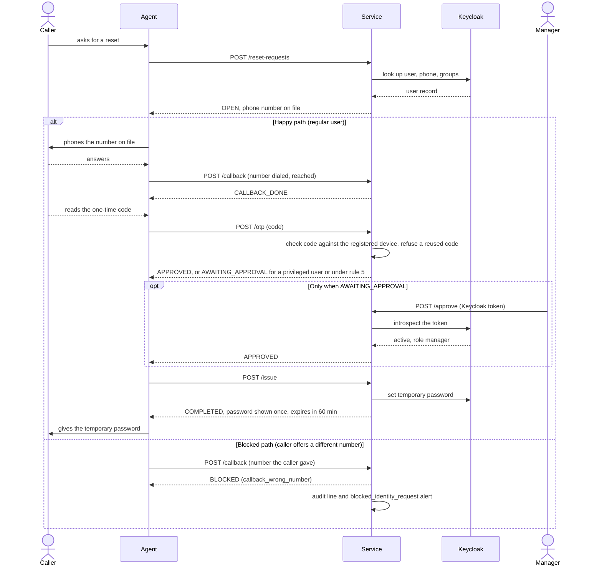

# 1H Verified Reset Service

A small web service that a helpdesk agent drives to run a password or MFA reset. The service refuses out-of-order steps, so a reset only completes if the verification steps happened, in order, and every decision is written to an audit log.

Everything here is a lab on fictional data (Maple Harbour Credit Union, `mapleharbour.example`). Keycloak, an open-source identity server, plays the company's login system.

## What it does

The service is built (with FastAPI, a Python web framework) around the public advisory AL26-010 ("out-of-band verification procedures for identity-related requests"). The pattern it targets: an attacker phones the helpdesk, talks the agent into resetting a password, then asks for the MFA (multi-factor authentication, the second proof of identity, such as a phone app code) to be reset or moved to the attacker's phone. Real incidents are cited only as public reporting; the Clorox sequence used in the tests is **alleged**.

A request moves through fixed checks. The five rules:

1. **Callback to the number on file.** The agent phones the number stored for the user, never a number the caller offers. A different number, or nobody answering, blocks the request.
2. **One-time code from the registered device.** The user reads out the current 6-digit code from their phone app. Three wrong codes block the request. A user with no registered device is escalated to a person. A code can be used once: the service remembers the newest 30-second time step it accepted per user, and refuses that step or any older one (a replay counts as a failed try).
3. **Manager approval for privileged accounts.** Accounts in the `privileged` group need a manager's Keycloak login token with the `manager` role. The approver cannot be the person being reset, and cannot be the agent running the request.
4. **Temporary password that dies after 60 minutes.** A password reset issues a random temporary password, shown once. Keycloak's "temporary" flag only forces a change at next login and does not time-limit the password, so this service does: a maintenance job rotates any temporary password older than 60 minutes to a value nobody is told.
5. **24-hour watch.** An MFA-kind request (`mfa_reset`, `mfa_enrol_device`, `mfa_change_phone`) that is created or continued within 24 hours after a **completed** password reset for the same user writes an alert and is forced to need a manager's approval, even for a regular user. Why: "reset the password, then reset the MFA" is the takeover pattern in AL26-010, so a second person must look before the second step. The rule is checked at create, at the code step and at `issue`, because a reset can complete while an MFA request is already open. The window is inclusive: exactly 24 hours still alerts, 24 hours and one second does not.

Every request and every refusal is also written to `audit.jsonl`, one JSON object per line (`ts, request_id, actor, action, outcome, details`). Every request that ends `BLOCKED` also writes a `blocked_identity_request` alert to `alerts.jsonl`, once per request, except for the reasons `unknown_user` and `no_phone_on_file` (no real account was at risk; those are still in the audit log).

### How a request flows

## How to run

Run these from the repository root unless stated.

1. **Python environment** (never install system-wide):
   `python3 -m venv .venv && . .venv/bin/activate && pip install -r requirements.txt`
2. **Start Keycloak and build the dev realm.**
   `bash 1h-verified-reset/scripts/keycloak-dev.sh`
   It starts Keycloak if port 8080 is silent (about 45 seconds on first start; log in `/tmp/keycloak.log`), then creates realm `maple-harbour`. Running it again changes nothing. It prints status lines only; secrets go to `1h-verified-reset/.dev/` (gitignored) and are never printed. The Keycloak admin password is a documented throwaway for a local test server: `dev-only-not-secret`. The dev data may be gone next session, so re-run the script.
3. **Start the service** (8080 belongs to Keycloak, so the service uses 8000):
   `cd 1h-verified-reset && uvicorn app.main:app --port 8000`
   Settings by environment variable: `KEYCLOAK_URL` (default `http://localhost:8080`), `KEYCLOAK_REALM` (`maple-harbour`), `AUDIT_LOG_PATH` (`audit.jsonl`), `ALERTS_LOG_PATH` (`alerts.jsonl`), `SEEDS_PATH` and `CLIENT_SECRET_PATH` (files in `.dev/`).
4. **Tests.**
   - Unit and replay tests (Keycloak is replaced by a fake): `pytest -q 1h-verified-reset/tests/unit 1h-verified-reset/tests/replay`
   - Integration tests against the real Keycloak: `pytest -q -m keycloak`
   - `pytest -q` runs everything. If `GET <KEYCLOAK_URL>/realms/maple-harbour` does not answer 200, `tests/conftest.py` marks the integration tests **skipped**, not failed.
5. **Replay runner** (scripted attack cases, from `1h-verified-reset/`):
   - offline, against the fake: `python -m app.replay`
   - one case against a running service: `python -m app.replay --base-url http://localhost:8000 tests/replay/T07.yaml`
   It prints the request state after every step. A one-time code in a case file is written `{totp:priya.nair}` and filled in at run time from the dev seed file. The service refuses a code it already accepted, so if you used a code for the same user in the last 30 seconds (for example with curl), wait for the next code step before running a case that needs one.
6. **One-command demo:** `bash 1h-verified-reset/demo.sh` (needs Keycloak; see [DEMO.md](DEMO.md) for a saved run with secrets masked).

Dev users (the same fictional staff as the 1E tickets): `priya.nair` (regular, has a code device), `daniel.okafor` (group `privileged`, has a device), `marcus.chen` (role `manager`, password generated into `.dev/`), `sofia.alvarez` (regular, no device).

### Endpoints

| Call | What it does |
|---|---|
| `POST /reset-requests` `{kind, claimed_username, agent_id, channel}` (+ `new_phone` for `mfa_change_phone`) | `kind` is `password`, `mfa_reset`, `mfa_enrol_device` or `mfa_change_phone`. Shows the phone number on file. |
| `POST /reset-requests/{id}/callback` `{number_dialed, reached}` | Records the callback. |
| `POST /reset-requests/{id}/otp` `{code}` | Checks the one-time code. |
| `POST /reset-requests/{id}/approve` (header `Authorization: Bearer <token>`) | Manager approval. |
| `POST /reset-requests/{id}/issue` | Does the reset. |
| `GET /reset-requests/{id}` | State and history, no secrets. |
| `POST /mfa-change-events` `{username, change, source}` | Reports an MFA change seen outside the service. |
| `GET /alerts` | Lists alerts. |
| `POST /maintenance/expire-temp-passwords` | Rotates temporary passwords older than 60 minutes. |

### State machine

Normal path: `OPEN` -> `CALLBACK_DONE` -> `OTP_VERIFIED` -> (`AWAITING_APPROVAL` ->) `APPROVED` -> `COMPLETED`.

- `OPEN`: request created, user found, phone number on file shown.
- `CALLBACK_DONE`: callback reached the number on file.
- `OTP_VERIFIED`: code correct. It moves on at once to `AWAITING_APPROVAL` (privileged user, or rule 5) or `APPROVED`.
- `AWAITING_APPROVAL`: waiting for a manager.
- `APPROVED`: ready to issue.
- `COMPLETED`: the reset was done.
- `BLOCKED`: a check failed (`unknown_user`, `no_phone_on_file`, `callback_wrong_number`, `callback_not_reached`, `otp_failed`).
- `ESCALATED`: the user has no registered device (`no_registered_device`), so a person must handle it outside this tool.

Each step works from exactly one state: callback from `OPEN`, code from `CALLBACK_DONE`, approve from `AWAITING_APPROVAL`, issue from `APPROVED`. Anything else gets **HTTP 409** and an `out_of_order` audit line. At `issue`, a request that was approved without a manager but now falls under rule 5 is refused with 409 (`needs_approval_rule5`) and moved back to `AWAITING_APPROVAL`.

### The audit log

`app/audit.py` offers `record()` (and `record_alert()`), nothing that edits, deletes or shortens the file, and every write opens the file in append mode. A test (`tests/unit/test_audit_log.py`) runs a full scenario and checks that the file only ever grows, that every line is valid JSON with the six fields, and that no generated password, code or token value appears in it.

## Design decisions

**D1: how the service checks a one-time code (option 2, chosen).** Keycloak has no admin call that says "is this code valid for user X". So `keycloak-dev.sh` keeps a copy of each test user's authenticator secret (the "seed") in `.dev/seeds.json`, and the service checks codes with the `pyotp` library, accepting the current 30-second step and one either side. A real deployment would never hold seeds outside the identity provider. Option 1 (a special login flow in Keycloak that accepts the code without a password) was not attempted; `TODO(verify)` against the Keycloak 26 documentation if it is ever tried.

**D2: how the service checks the manager's token (option a, chosen).** The service asks Keycloak to introspect the token ("is this login ticket still valid, and whose is it?") using the confidential client `reset-service`, whose secret the script generates into `.dev/reset-service.secret`. The service also requires `reset-service` in the token's audience, type `Bearer`, the `manager` realm role, and an approver who is neither the person being reset nor the agent. No extra library is needed.

### Things the build needed that were not in the plan

- Keycloak 26 silently drops custom user attributes, so the script declares `phone` in the realm's user profile.
- A public client `helpdesk-console` lets a manager log in and get a token. It has an audience mapper adding `reset-service`, because on Keycloak 26.8.1 introspection answered "not active" without it. `TODO(verify)`: that this is documented Keycloak behaviour.
- The service uses its own Keycloak account (the service account of `reset-service`) with only manage-users, view-users, query-users and query-groups. It never holds an admin password.
- `mfa_change_phone` needs the new number, so create takes an optional `new_phone` (required for that kind, otherwise 422).
- A wrong code answers 200 with the state unchanged and `otp_attempts_left`; the third wrong code blocks.
- `approve` checks the token first (403 plus an audit line for a missing, invalid, non-manager, self-approver or agent token), then the step order (409).
- Temporary-password rotation skips a user who already chose their own password (Keycloak's `UPDATE_PASSWORD` action is gone), and acts only on the newest temporary password per user.
- A rule-5 alert is written when the MFA request is created, even if the request is later blocked; the later checks (code step, issue) never write a second alert for the same request.
- `mfa_enrol_device` only asks Keycloak to require TOTP setup; the new device's seed is not in the dev copy (D1), so the service cannot check codes for it. For a user with no device, a later code step ends `ESCALATED`.
- Each step handler holds one lock for its whole body, so two parallel calls cannot both pass a state check or beat the three-try limit (tested). Odd answers from Keycloak (a missing id or name) fail closed with a 502 and an audit line.
- `app/fake_keycloak.py` ships with the package because the unit tests and the offline replay runner use it, but nothing switches the running service to it: only test and replay dependency overrides do. Normal runs always talk to the real Keycloak.

## What Eojin did and what Claude did

Eojin chose the design decisions (D1, D2, rule 5, the blocked-request alert and its exceptions, the 5-second timeout with one global lock) and decides each replay case's expected end state; he reviews the code and explains it back. The ticket transcripts (T07 to T10) and, later, the 1A attack scripts are Eojin's to write. Claude wrote the service, tests, runner, scripts and this README under the repository's `CLAUDE.md` rules, with a separate review pass from other Claude models; details are in `AI-USE.md` and `docs/verify/`. Claude wrote no social-engineering script: the replay cases are API calls only.

## Results

Replay cases run offline against the fake Keycloak (`python -m app.replay`; `tests/replay/test_replay.py` asserts them). The dev users stand in for the people in the tickets. The ticket transcripts are not written yet, so each case is built from the ticket's description and pressure type.

| Case | Pressure | What the replay tries | Final state | Alerts |
|---|---|---|---|---|
| T07 (`daniel.okafor`, privileged) | urgency | code step before callback (409), issue (409), callback not reached | `BLOCKED` | 1 |
| T08 (`priya.nair`, `mfa_enrol_device`) | claimed new phone | callback to the number the caller offered | `BLOCKED` | 1 |
| T09 (`sofia.alvarez`) | skip the callback | code step (409) and issue (409) before callback; then callback to the number on file, answered | `ESCALATED` (no registered device) | 0 |
| T10 (`daniel.okafor` as stand-in for the ticket's Jae-won Park) | impersonating a manager | approve with no token (403), issue (409), callback not reached | `BLOCKED` | 1 |
| Clorox, alleged (`priya.nair`) | none verified | password, then `mfa_reset`, then `mfa_change_phone`, each with the callback going to the caller's own number | `BLOCKED` x 3 | 3 |
| Control (`priya.nair`) | none: a genuine reset | callback on file, correct code, issue | `COMPLETED` | 0 |

Notes on the table: T07 and T10 differ only in the token-less approve step in T10, because the service's only approval route is a manager's Keycloak token. The Clorox replay exercises the callback rule; rule 5 does not fire in it because nothing completes. Rule 5 is covered by the unit tests instead (both sides of the 24-hour boundary, at create, code and issue). The replay cases test the service's rules, not an agent's judgement: the agent is tested in 1A.

The control is there so that "every attack ended `BLOCKED`" cannot be satisfied by a service that blocks everything.

## Limits

- **The callback is simulated.** The agent reports what happened when they phoned; the service cannot hear the call. It refuses out-of-order steps; it cannot stop an agent from lying about having called.
- **No endpoint authenticates the agent.** That includes `/mfa-change-events` and `/maintenance/*`. Only `approve` checks a token.
- **One-time codes use a dev copy of the seed (D1).** A real deployment would never hold seeds outside the identity provider.
- **Temporary-password expiry is enforced by this service, not by Keycloak.** Keycloak's "temporary" flag forces a change at next login but has no time limit. The 60-minute rotation runs when the maintenance endpoint is called; nothing calls it on a schedule yet.
- **The audit log has no hash chain, by design.** The module cannot edit or delete lines, but someone with write access to the file can still edit it. A hash chain, or shipping the log to another system, is the next step and is out of scope here.
- **Requests are held in memory.** A restart forgets them, including the 24-hour watch's memory of recent password resets and the record of which code time steps were used (so a code replay is only refused while the service stays up).
- **The service's memory of used codes is its own.** Because the dev setup checks codes in the service (D1), a code the user just typed at Keycloak's own login page can still be used once at the service, and the other way round. A real deployment would ask the identity provider to check the code, so there would be one memory.
- **Rule 5 only sees password resets completed through this service.** Resets done any other way are invisible to it.
- **One global lock and a 5-second Keycloak timeout.** Every step runs under one lock so parallel calls cannot beat the rules, so one slow Keycloak call makes other requests wait. The timeout is kept at 5 seconds to bound that. Per-user locks would be faster but more code to explain.
- **`mfa_enrol_device` for a user with no device ends `ESCALATED`** at the code step, since there is no device to check a code against.
- **Single node, plain HTTP, `start-dev` Keycloak:** lab settings only.
